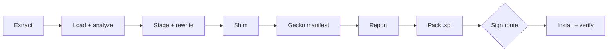

# Chrome-to-Firefox converter design

This is a command-line tool that converts a Chrome extension into a Firefox add-on and installs it. It is the Firefox counterpart of viaduct-cli, which does the same for Safari, and it aims for feature parity with that CLI. The Viaduct Mac app may bundle it later, so it keeps viaduct-cli's process contract.

The tool is called lavaduct. Every identifier that carries the name comes from `src/name.ts`; see Naming below.

## Goals

- Take the same inputs as viaduct-cli: a Chrome Web Store URL, a direct `.crx`/`.zip` link, a `.crx`, `.zip` or `.xpi` file, or an unpacked directory. Batch runs take several inputs at once.
- Produce an `.xpi` that runs in Firefox, and install it into a Firefox profile when asked.
- Run on macOS, Windows and Linux.
- Have no runtime dependencies, so the Viaduct app can run the published npm tarball directly with its bundled Node.
- Offer every viaduct-cli feature that has a Firefox meaning (see the flag table below).

## Non-goals

These stay out of the CLI, as they do for Safari, and belong to an app later:

- An "Add to Firefox" button on Chrome Web Store pages.
- Importing extensions from installed Chromium browsers.
- Carrying an extension's `chrome.storage` settings over from Chrome.
- Weekly re-conversion of store installs.
- Installing onto Firefox for Android. The CLI writes the `gecko_android` manifest settings but does not push to a device.

## Package and runtime

- npm package `@magicelk235/lavaduct`, binary `lavaduct`.
- TypeScript compiled to ESM. Node 22.13 or newer, for the global `WebSocket` and `node:sqlite`.
- No runtime dependencies. `@mdn/browser-compat-data` is a dev dependency used only to generate the compatibility table at build time.
- All child processes go through one `run()` wrapper in `src/util.ts`, as in viaduct-cli. Anything OS specific lives under `src/firefox/platform/`.
- License: PolyForm Shield 1.0.0, matching viaduct-cli.

## Source layout

```
src/
  cli.ts            argument parsing, config file, subcommands, batch runs
  convert.ts        pipeline orchestrator
  util.ts paths.ts types.ts
  input/            download.ts extract.ts stage.ts icons.ts
  zip/              read.ts write.ts
  manifest/         manifest.ts compat-data.ts dnr.ts
  analyze/          analyze.ts report.ts
  runtime/          shim.ts firefox-compat-shim.js oauth-bridge.ts debug-ring.js
  sign/             amo.ts
  firefox/          locate.ts profiles.ts rdp.ts bidi.ts install.ts storage.ts
                    platform/darwin.ts platform/win32.ts platform/linux.ts
scripts/
  gen-compat.ts     builds the native/unsupported columns of compat-data.ts from MDN data
```

`input/`, the manifest parser, and the shape of `analyze/` are copied from viaduct-cli and then adapted. viaduct-cli uses `ditto` and `unzip`, which are macOS tools, so `zip/` replaces them with a reader and writer built on `node:zlib` (deflate/inflate plus CRC32). Fixes to the copied modules in viaduct-cli, such as CRX parsing or Web Store download changes, have to be ported by hand.

## Pipeline



1. Extract. Detect the input type from magic bytes, strip the CRX header, unzip.
2. Load and analyze. Parse the manifest, scan sources, and count blocking issues. The run stops on blocking issues unless `--force` is set.
3. Stage. Copy the files the manifest references and apply source rewrites.
4. Shim. Write the compatibility shim and inject it into background scripts, content scripts and extension HTML pages.
5. Transform the manifest for Firefox.
6. Write the report. `--analyze` stops after this step.
7. Pack the staged directory into an `.xpi`.
8. Pick and run a signing route.
9. Install into a profile and optionally verify.

Progress lines stay stable so the Viaduct app can map them to phases the way it does for viaduct-cli today. The lines that mark phase changes are `Packing .xpi`, `Signing (amo|unsigned|temporary)` and `Installed →`.

## Manifest transform

- Set `browser_specific_settings.gecko.id` from `--addon-id`, or use the derived ID described under signing.
- Set `browser_specific_settings.gecko.strict_min_version` from `--min-firefox`. The default is the current ESR major version.
- With `--platforms android` or `all`, also write `browser_specific_settings.gecko_android`.
- Convert `background.service_worker` into `background.scripts`. Firefox runs background scripts as event pages rather than service workers. Scripts loaded through a literal `importScripts(...)` list are moved into the `scripts` array ahead of the worker, using viaduct-cli's hoisting logic. `background.type: "module"` is kept because Firefox supports module background scripts.
- Rewrite `chrome-extension://` to `moz-extension://` in staged sources.
- Remove `key`, `update_url` and `minimum_chrome_version`.
- Map `side_panel` to `sidebar_action`. `--panel-query` controls the query string on the sidebar page, with the same default as viaduct-cli.
- Replace `externally_connectable` with the page bridge from viaduct-cli's `oauth-bridge.ts`. `--no-oauth-bridge` turns this off.
- Run `dnr.ts` with Firefox's declarativeNetRequest rule limits and supported actions.
- Change `incognito: "split"` to `"spanning"` and warn, because Firefox does not support split mode.

## Compatibility table

`manifest/compat-data.ts` lists each permission and `chrome.*` API with one of four outcomes: native, shimmed, stripped, or blocking. `scripts/gen-compat.ts` fills in whether Firefox supports each entry, at the chosen minimum version, from `@mdn/browser-compat-data`. The shim and strip decisions are kept by hand on top of that. `--analyze` and the transform both read this table, so the report and the output always agree.

## Shim

`runtime/firefox-compat-shim.js` covers the gaps between Chrome's API and Firefox's. Firefox already provides the `chrome` namespace with callbacks, blocking `webRequest`, `scripting` with `world: "MAIN"`, and declarativeNetRequest, so the shim is much smaller than viaduct-cli's Safari one. The planned contents are:

- `chrome.sidePanel.*` on top of `sidebarAction`.
- `chrome.offscreen.*` using a hidden iframe in the event page, since Firefox's background page has a DOM.
- `chrome.identity.getAuthToken` on top of `launchWebAuthFlow`, ported from viaduct-cli's `identity-polyfill.js`.
- `chrome://favicon` and `_favicon` URLs.
- Smaller `runtime` and `tabs` gaps found while testing against the extension corpus.

The shim is injected first in background scripts, every content script and every extension HTML page. `--no-shim` skips it. `--debug` builds the shim with the tracing ring buffer from viaduct-cli, which keeps the last 2000 entries in `storage.local` under `__viaduct_debug_log__`.

## Signing and install

### Route selection

`--sign auto` is the default. It uses the first route that applies and prints which one it chose and why:

1. `amo`, when AMO credentials are configured.
2. `unsigned`, when the target Firefox is Nightly, Developer Edition, ESR or an unbranded build. These builds can turn off signature enforcement.
3. `temporary` otherwise.

`--sign amo|unsigned|temporary` forces a route. A forced route that cannot work, for example `unsigned` against release Firefox, fails with an explanation.

### AMO route

Credentials come from `--amo-key` and `--amo-secret`, the environment variables `LAVADUCT_AMO_KEY` and `LAVADUCT_AMO_SECRET`, web-ext's `WEB_EXT_API_KEY` and `WEB_EXT_API_SECRET`, or the config file, in that order of precedence.

`sign/amo.ts` talks to AMO's v5 API:

1. Build a JWT (HS256 via `node:crypto`) with `iss` set to the key, a random `jti`, and a 60-second expiry. A fresh token is made for every request.
2. Upload the `.xpi` with `channel=unlisted` and poll the upload until validation finishes. Validation errors are added to the conversion report and the run exits 1.
3. Create the add-on, or a new version if the add-on ID already exists on the account.
4. Poll the version until its file is signed, then download the signed `.xpi`.

AMO add-on IDs belong to whoever submits them first, so an ID like `dark-reader@viaduct` would collide between users. The derived ID is `<chromeId>.<salt>@lavaduct`, where `chromeId` is the Web Store ID (or a hash of the manifest name for local inputs) and `salt` is 8 random hex characters created once and kept in the state directory. The same user converting the same extension always gets the same ID, so updates replace the existing add-on and keep its storage.

AMO will not sign the same version number twice for one add-on. Signed files are cached in the state directory by add-on ID and a SHA-256 of the packed contents, so re-running an unchanged conversion reuses the cached file. If the contents changed but the upstream version did not, the signed build gets a fourth version component one higher than the last one signed. If the upstream version already has four components, the run fails and suggests `--addon-version <x.y.z.w>`.

If signing has not finished after 15 minutes, the run stores the upload ID against the add-on ID and content hash, prints the AMO status URL, and exits 1. The next run with the same input resumes polling instead of uploading again.

Unlisted add-ons are still subject to Mozilla's add-on policies and can be reviewed after signing. Obfuscated code may be rejected, and a signed add-on can later be disabled. The README states this, and the first AMO run on a machine prints a one-time notice.

### Unsigned route

Write `user_pref("xpinstall.signatures.required", false);` to the profile's `user.js`. If the pref was not already active and Firefox is running, Firefox has to restart for it to apply. The CLI quits and relaunches Firefox unless `--no-firefox-restart` is set, in which case it prints what the user still needs to do.

### Installing a signed or unsigned .xpi

The CLI launches the chosen Firefox with the profile and the `.xpi` path (`firefox -P <profile> <file.xpi>`, or `--profile <path>` for a path). Firefox shows its normal install prompt, and this works whether Firefox is already running or not. `--no-launch` stops once the `.xpi` is written. `--verify` polls the profile's `extensions.json` until the add-on ID is present, enabled and at the expected version, and fails after 60 seconds.

### Temporary route

The CLI starts Firefox with a remote debugging port and installs the add-on over WebDriver BiDi with `webExtension.install` (`firefox/bidi.ts`). When the Firefox version does not support that command, it uses the older remote debugging protocol's `installTemporaryAddon` instead (`firefox/rdp.ts`). Both clients use only Node built-ins.

By default the temporary add-on goes into a dedicated `lavaduct` profile, which the CLI creates if needed, so remote debugging is never turned on in the user's own profile. `--profile` puts it in a named profile instead; the CLI writes the required devtools prefs to that profile's `user.js` and lists them in its output. The add-on is removed when Firefox restarts.

## Firefox discovery

`firefox/locate.ts` finds installs on each OS:

- macOS: known `.app` names in `/Applications` and `~/Applications`, then `mdfind` on Mozilla's bundle identifiers for release, Developer Edition and Nightly.
- Windows: `reg query` on `HKLM` and `HKCU\SOFTWARE\Mozilla\<product>\<version>\Main\PathToExe`, with Program Files as a fallback.
- Linux: `firefox`, `firefox-esr`, `firefox-developer-edition` and `firefox-nightly` on `PATH`, plus snap and flatpak installs.

The channel comes from `defaults/pref/channel-prefs.js` and the version from `application.ini` in the install directory. `--firefox <path|channel>` selects an install; without it the CLI uses the release channel if present, otherwise the first install found.

`firefox/profiles.ts` reads `profiles.ini` and `installs.ini` from each OS's profile root, including the snap (`~/snap/firefox/common/.mozilla/firefox`) and flatpak (`~/.var/app/org.mozilla.firefox/.mozilla/firefox`) locations. Each install's default profile comes from its `[Install<hash>] Default=` entry. `--profile` takes a profile name or a path. A profile counts as in use when its `lock` or `.parentlock` is held.

## Commands

| viaduct-cli | this CLI |
|---|---|
| `<input>`, batch `<in1> <in2> …` | same |
| `-o, --output <dir>` | same, default `./<Name>_Firefox` |
| `--bundle-id <id>` | `--addon-id <id>` |
| `--app-name <name>` | dropped, there is no host app |
| `--min-safari <ver>` | `--min-firefox <ver>` |
| `--platforms all\|macos\|ios` | `--platforms all\|desktop\|android`, default `desktop` |
| `--ci`, `--no-build`, `--open-xcode` | dropped, there is no Xcode project |
| `--temp-load` | `--sign temporary` |
| `--zip` | an `.xpi` is always written; `--zip` also writes the unsigned zip |
| `--clean` | same |
| `--install`, `--install-dir`, `--verify` | `--install`, `--profile`, `--firefox`, `--verify` |
| `--no-safari-restart` | `--no-firefox-restart` |
| `--background-launch` | `--no-launch` |
| `--team <id>` | `--sign <route>`, `--amo-key`, `--amo-secret`, `--addon-version` |
| `--no-shim`, `--no-oauth-bridge`, `--panel-query`, `--debug` | same |
| `--keep-module` | dropped, module background scripts are always kept |
| `--force`, `--strict`, `--analyze`, `--json`, `--report`, `--config` | same; config file is `lavaduct.config.json` |
| `--doctor`, `--list`, `--uninstall`, `--logs` | re-targeted at Firefox, described below |
| `-q`, `-v`, `-h`, `--version` | same |

`--doctor` lists each Firefox install with its channel, version and whether it can run unsigned add-ons; each profile, marking the default and any in use; the Node version; whether AMO credentials are present, with a live check against the AMO API; and the config and state directories.

`--list` reads `extensions.json` in the chosen profile, or every profile of the chosen install, and prints each add-on's name, ID, version and enabled state. Add-ons this CLI installed are marked.

`--uninstall <name|id>` deletes `<profile>/extensions/<id>.xpi` while Firefox is closed; Firefox drops the add-on on its next start. If Firefox is running, the CLI quits it, removes the file and relaunches it. With `--no-firefox-restart` it refuses instead. The signed-file cache entry for that ID is removed too.

`--logs <name|id>` prints the `--debug` ring buffer from a profile. It maps the add-on ID to its internal UUID through `extensions.webextensions.uuids` in `prefs.js`, opens `storage/default/moz-extension+++<uuid>^userContextId=4294967295/idb/*.sqlite` read-only with `node:sqlite`, and decodes the stored value. Firefox stores IndexedDB values Snappy-compressed in its structured-clone format; `firefox/storage.ts` contains a Snappy decoder ported from viaduct-app's `Snappy.swift` and a structured-clone decoder for the plain-data subset the ring buffer uses (objects, arrays, strings, numbers, booleans, null).

## Files on disk

- Config: `./lavaduct.config.json`, keyed by long flag name. Flags on the command line override it.
- State (ID salt, install records, pending AMO uploads): `~/Library/Application Support/lavaduct` on macOS, `%APPDATA%\lavaduct` on Windows, `$XDG_CONFIG_HOME/lavaduct` on Linux.
- Signed `.xpi` cache: the state directory on macOS and Windows, `$XDG_CACHE_HOME/lavaduct` on Linux.
- The AMO secret is only read from a flag, the environment or the config file. The CLI never writes it to disk.

## Naming

Every identifier that carries the name comes from one module, `src/name.ts`: the binary and package name, the environment variable prefix, the config file name, the state and cache directories, the dedicated temporary profile, and the add-on ID suffix. Renaming the tool means changing that file plus `package.json`.

The add-on ID suffix is the one identifier that cannot change after release. Signed add-ons are tied to their ID on AMO and in each user's profile, so a later rename of the suffix would make every converted add-on install as a new, separate add-on with empty storage.

## Errors and exit codes

Issues have a severity of error, warning or info. Errors block the run unless `--force` is set; `--strict` makes warnings block too. Exit codes match viaduct-cli: 0 for success and 1 for a blocked or failed conversion. In a batch run each input is converted independently, a summary follows, and the exit code is 1 if any input failed. When no usable Firefox install or profile is found, the message names the fix in the same words `--doctor` uses.

## Testing

Unit tests run with `node --test`, one file per behaviour or quirk:

- Manifest transforms and compatibility table outcomes.
- Zip read and write round trips on real CRX and ZIP files, and CRX header stripping.
- The AMO JWT against a known test vector, add-on ID derivation, and version stamping.
- `profiles.ini`, `installs.ini` and `extensions.json` parsing from fixtures for each OS, and channel detection.
- Snappy and structured-clone decoding on fixtures captured from a real Firefox profile.

Integration tests run in GitHub Actions on macOS, Windows and Linux with Firefox Nightly. They convert a small fixture corpus, install through the unsigned and temporary routes, and check that each add-on is active. The large real-extension corpus (Dark Reader, MetaMask, Tampermonkey, LastPass and others) stays local, as it does for viaduct-cli.

An opt-in AMO test runs when `AMO_TEST_KEY` and `AMO_TEST_SECRET` are set. It signs one small fixture add-on with a fixed ID as unlisted.

## Release

A GitHub Release triggers a workflow, copied from viaduct-cli, that publishes to npm through OIDC trusted publishing. The README covers install, usage, each signing route, and the AMO policy risk.

For the Viaduct app, the stable contract is the `--analyze --json` schema (the same as viaduct-cli's), the phase progress lines listed under Pipeline, AMO credentials passed through environment variables, and the exit codes above.

## To verify before implementation

These rest on general knowledge of Firefox and must be checked against current Firefox and AMO behaviour before the code that depends on them is written:

- The current ESR major version used as the `--min-firefox` default.
- AMO v5 endpoint paths and payloads for upload, add-on creation, version creation and signed-file download, and the maximum JWT lifetime.
- Which Firefox version first supports WebDriver BiDi `webExtension.install`.
- That Firefox removes an add-on whose `.xpi` was deleted from `<profile>/extensions/` while it was closed.
- That `node:sqlite` can read a profile's IndexedDB files while Firefox has them open in WAL mode.
- That passing an `.xpi` path on the command line shows the install prompt in an already running Firefox on all three OSes.
- Which Firefox builds honour `xpinstall.signatures.required = false`, and how to tell them apart from release and beta.
