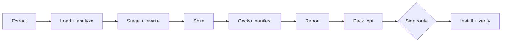

# Chrome-to-Firefox converter design

This is a command-line tool that converts a Chrome extension into a Firefox add-on and installs it. It is the Firefox counterpart of viaduct-cli, which does the same for Safari, and it aims for feature parity with that CLI. The Viaduct Mac app may bundle it later, so it keeps viaduct-cli's process contract.

The tool is called lavaduct. Every identifier that carries the name comes from `src/name.ts`; see Naming below.

## Goals

- Take the same inputs as viaduct-cli: a Chrome Web Store URL, a direct `.crx`/`.zip` link, a `.crx`, `.zip` or `.xpi` file, or an unpacked directory. Batch runs take several inputs at once.
- Produce an `.xpi` that runs in Firefox, and install it into a Firefox profile when asked.
- Run on macOS, Windows and Linux.
- Have no runtime dependencies, so the Viaduct app can run the published npm tarball directly with its bundled Node.
- Offer every viaduct-cli feature that has a Firefox meaning (see the flag table below).

## Non-goals

These stay out of the CLI, as they do for Safari, and belong to an app later:

- An "Add to Firefox" button on Chrome Web Store pages.
- Importing extensions from installed Chromium browsers.
- Carrying an extension's `chrome.storage` settings over from Chrome.
- Weekly re-conversion of store installs.
- Installing onto Firefox for Android. The CLI writes the `gecko_android` manifest settings but does not push to a device.

## Package and runtime

- npm package `@magicelk235/lavaduct`, binary `lavaduct`.
- TypeScript compiled to ESM. Node 22.13 or newer, for the global `WebSocket` and `node:sqlite`.
- No runtime dependencies. `@mdn/browser-compat-data` is a dev dependency used only to generate the compatibility table at build time.
- All child processes go through one `run()` wrapper in `src/util.ts`, as in viaduct-cli. Anything OS specific lives under `src/firefox/platform/`.
- License: PolyForm Shield 1.0.0, matching viaduct-cli.

## Source layout

```
src/
  cli.ts            argument parsing, config file, subcommands, batch runs
  convert.ts        pipeline orchestrator
  util.ts paths.ts types.ts
  input/            download.ts extract.ts stage.ts icons.ts
  zip/              read.ts write.ts
  manifest/         manifest.ts compat-data.ts dnr.ts
  analyze/          analyze.ts report.ts
  runtime/          shim.ts firefox-compat-shim.js oauth-bridge.ts debug-ring.js
  sign/             amo.ts
  firefox/          locate.ts appconstants.ts profiles.ts cityhash.ts bidi.ts launch.ts
                    install.ts extensions-json.ts storage.ts snappy.ts structured-clone.ts
                    platform/darwin.ts platform/win32.ts platform/linux.ts
scripts/
  gen-compat.ts     builds the native/unsupported columns of compat-data.ts from MDN data
```

`input/`, the manifest parser, and the shape of `analyze/` are copied from viaduct-cli and then adapted. viaduct-cli uses `ditto` and `unzip`, which are macOS tools, so `zip/` replaces them with a reader and writer built on `node:zlib` (deflate/inflate plus CRC32). Fixes to the copied modules in viaduct-cli, such as CRX parsing or Web Store download changes, have to be ported by hand.

## Pipeline



1. Extract. Detect the input type from magic bytes, strip the CRX header, unzip.
2. Load and analyze. Parse the manifest, scan sources, and count blocking issues. The run stops on blocking issues unless `--force` is set.
3. Stage. Copy the files the manifest references and apply source rewrites.
4. Shim. Write the compatibility shim and inject it into background scripts, content scripts and extension HTML pages.
5. Transform the manifest for Firefox.
6. Write the report. `--analyze` stops after this step.
7. Pack the staged directory into an `.xpi`.
8. Pick and run a signing route.
9. Install into a profile and optionally verify.

Progress lines stay stable so the Viaduct app can map them to phases the way it does for viaduct-cli today. The lines that mark phase changes are `Packing .xpi`, `Signing (amo|unsigned|temporary)` and `Installed →`.

## Manifest transform

- Set `browser_specific_settings.gecko.id` from `--addon-id`, or use the derived ID described under signing.
- Set `browser_specific_settings.gecko.strict_min_version` from `--min-firefox`. The default is 153, the current ESR. It is a constant in the source, raised at each new ESR (175 arrives on 2027-06-29).
- With `--platforms android` or `all`, also write `browser_specific_settings.gecko_android` (an empty object enables Android without a version range).
- Write `browser_specific_settings.gecko.data_collection_permissions` only when `--data-collection <list>` is given (for example `--data-collection none`). The tool can't know what a third-party extension collects, so it never fills this in on its own. AMO requires the key for new add-ons; when it's missing, the AMO route passes on AMO's warning.
- Convert `background.service_worker` into `background.scripts`. Firefox runs background scripts as event pages rather than service workers. Scripts loaded through a literal `importScripts(...)` list are moved into the `scripts` array ahead of the worker, using viaduct-cli's hoisting logic. `background.type: "module"` is kept because Firefox supports module background scripts.
- Rewrite `chrome-extension://` to `moz-extension://` in staged sources.
- Remove `key`, `update_url` and `minimum_chrome_version`.
- Map `side_panel` to `sidebar_action`, with `open_at_install: false` so Firefox does not open the sidebar on install. An extension that declares no `side_panel` but hands its page to `chrome.sidePanel.setOptions({ path })` gets a `sidebar_action` for that page. `--panel-query` controls the query string on the sidebar page, with the same default as viaduct-cli; the shim also adds it to panel paths set at runtime that don't set its keys.
- When the shim emulates `chrome.debugger`, add the permissions it runs on (`scripting`, `tabs`, `webNavigation`, `webRequest`) and `<all_urls>` site access, and remove `debugger`. The report lists both changes.
- Replace `externally_connectable` with the page bridge from viaduct-cli's `oauth-bridge.ts`. `--no-oauth-bridge` turns this off.
- Run `dnr.ts` with Firefox's declarativeNetRequest limits: 20 enabled static rulesets, 30,000 static rules, 5,000 dynamic and 5,000 session rules, and 1,000 regex rules. Rules using conditions Firefox lacks (`responseHeaders`, `excludedResponseHeaders`, `domains`, `excludedDomains`) or resource types `webbundle`/`webtransport` are dropped with a warning, because Firefox drops invalid static rules silently.
- Delete `incognito: "split"` (giving the default, `spanning`) and warn. Firefox would otherwise fall back to `not_allowed`.
- Keep `content_scripts[].world: "MAIN"` (Firefox 128+) and MV3 `host_permissions` (granted at install from Firefox 127). When `--min-firefox` is set lower than those versions, `--analyze` reports them.

## Compatibility table

`manifest/compat-data.ts` lists each permission and `chrome.*` API with one of four outcomes: native, shimmed, stripped, or blocking. `scripts/gen-compat.ts` fills in whether Firefox supports each entry, at the chosen minimum version, from `@mdn/browser-compat-data`. The shim and strip decisions are kept by hand on top of that. `--analyze` and the transform both read this table, so the report and the output always agree.

## Shim

`runtime/firefox-compat-shim.js` covers the gaps between Chrome's API and Firefox's. Firefox already provides the `chrome` namespace with callbacks, blocking `webRequest`, `scripting` with `world: "MAIN"`, and declarativeNetRequest, so the shim is much smaller than viaduct-cli's Safari one. The planned contents are:

- `chrome.sidePanel.*` on top of `sidebarAction`.
- `chrome.offscreen.*` using a hidden iframe in the event page, since Firefox's background page has a DOM.
- `chrome.identity.getAuthToken`, `removeCachedAuthToken` and `getProfileUserInfo` on top of `launchWebAuthFlow`, ported from viaduct-cli's `identity-polyfill.js`. Firefox implements only `getRedirectURL` and `launchWebAuthFlow`.
- `chrome://favicon` and `_favicon` URLs.
- `chrome.debugger`, for add-ons that declare the permission or call the API (`runtime/cdp-emulation.js`, spliced in only then). It maps the DevTools protocol commands extensions drive tabs with onto Firefox's APIs: `Runtime.evaluate` (with V8's REPL mode and its compile errors, so clients that retry inside an async function do), `callFunctionOn` and `getProperties` through `scripting` in the page's world; `Input.*` as DOM events dispatched in the page; `Page.captureScreenshot` through `tabs.captureTab` (clips included, in device pixels); navigation and lifecycle events from `webNavigation`; `Network.*` events from `webRequest`; dialogs answered in the page and reported; console calls and uncaught errors from a hook in the page. The background page owns every session; extension pages forward their calls to it and hear its events, so a side panel and the background agree on what is attached. Limits: input is synthetic (`isTrusted` is false, no user activation), `Runtime.evaluate` fails on pages whose CSP forbids eval, response bodies aren't available, and cross-origin frames are reached only through Firefox's frame IDs.
- `ServiceWorkerGlobalScope` in a background that was a service worker, for bundles that ask whether they run in the worker; the extension's other pages keep answering no.
- `chrome://newtab` in `tabs.create`, `tabs.update` and `windows.create`, which Firefox refuses: those calls open Firefox's new tab page instead.
- The add-on's Chrome origin on its own requests to the hosts its CSP `connect-src` names, through a session DNR rule scoped to the add-on as initiator. Some backends allow an extension by its `chrome-extension://<id>` origin and refuse Firefox's random `moz-extension://` one.
- Smaller `runtime` and `tabs` gaps found while testing against the extension corpus.

The shim is injected first in background scripts, every content script and every extension HTML page. `--no-shim` skips it. `--debug` builds the shim with the tracing ring buffer from viaduct-cli, which keeps the last 2000 entries in `storage.local` under `__viaduct_debug_log__`.

## Signing and install

### Route selection

`--sign auto` is the default. It uses the first route that applies and prints which one it chose and why:

1. `amo`, when AMO credentials are configured.
2. `unsigned`, when the target Firefox build lets the user turn off signature enforcement. That is decided by reading `MOZ_REQUIRE_SIGNING` from the install's `omni.ja` (`modules/AppConstants.sys.mjs`). Nightly, Developer Edition, ESR and unbranded builds allow it; release and beta don't.
3. `temporary` otherwise.

`--sign amo|unsigned|temporary` forces a route. A forced route that cannot work, for example `unsigned` against release Firefox, fails with an explanation.

### AMO route

Credentials come from `--amo-key` and `--amo-secret`, the environment variables `LAVADUCT_AMO_KEY` and `LAVADUCT_AMO_SECRET`, web-ext's `WEB_EXT_API_KEY` and `WEB_EXT_API_SECRET`, or the config file, in that order of precedence.

`sign/amo.ts` talks to AMO's v5 API, following what web-ext does:

1. Every request carries `Authorization: JWT <token>`, an HS256 token (via `node:crypto`) with `iss` set to the key, `iat` now and `exp` 300 seconds later. A fresh token is made for each request.
2. `POST /api/v5/addons/upload/` with the `.xpi` and `channel=unlisted`, then poll `GET /api/v5/addons/upload/<uuid>/` every second until `processed` is true. If `valid` is false, AMO's validation messages are added to the conversion report and the run exits 1. AMO's warnings are printed but don't stop the run.
3. `PUT /api/v5/addons/addon/<guid>/` with `{"version":{"upload":"<uuid>"}}`. This creates the add-on (201) or a new version of it (200). Unlisted add-ons need no other metadata.
4. Poll `GET /api/v5/addons/addon/<guid>/versions/<version_id>/` every 5 seconds. `file.status` of `public` means signed; `disabled` means rejected and ends the run with exit 1.
5. Download `file.url`, sending the JWT header (AMO answers 404 without it for unlisted files).

A 429 response is retried after its `Retry-After` delay. AMO allows about 10 submissions per user per hour, so a large batch will wait; the CLI prints how long. A 403 on the PUT means the add-on ID belongs to another AMO account, and the run says so.

AMO add-on IDs belong to whoever submits them first, so an ID like `dark-reader@viaduct` would collide between users. The derived ID is `<chromeId>.<salt>@lavaduct`, where `chromeId` is the Web Store ID (or a hash of the manifest name for local inputs) and `salt` is 8 random hex characters created once and kept in the state directory. The derived ID has at most 80 characters from `[A-Za-z0-9._-]`, AMO's limit. The same user converting the same extension always gets the same ID, so updates replace the existing add-on and keep its storage.

AMO never accepts a version number that was used before for that add-on, even if that version was rejected or deleted. Signed files are cached in the state directory by add-on ID and a SHA-256 of the packed contents, so re-running an unchanged conversion reuses the cached file without contacting AMO. The state directory also records every version submitted per add-on ID. When the contents changed but the upstream version did not, or the PUT returns 409 because the version was used before, the build gets a fourth version component one higher than the highest one recorded, and is re-uploaded. If the upstream version already has four components, the run fails and suggests `--addon-version <x.y.z.w>`.

If signing has not finished after 15 minutes, the run stores the add-on ID, version ID and content hash, prints the AMO status URL, and exits 1. The next run with the same input resumes polling that version instead of uploading again.

Unlisted add-ons are still subject to Mozilla's add-on policies and can be reviewed after signing. Obfuscated or minified code may be rejected, a signed add-on can later be disabled, and from 2026-12-01 Mozilla's policy requires source code for machine-generated or minified code. The README states this, and the first AMO run on a machine prints a one-time notice.

### Unsigned route

Write `user_pref("xpinstall.signatures.required", false);` to the profile's `user.js`. If the pref was not already active and Firefox is running, Firefox has to restart for it to apply. The CLI quits and relaunches Firefox unless `--no-firefox-restart` is set, in which case it prints what the user still needs to do.

### Installing a signed or unsigned .xpi

The CLI launches the chosen Firefox with the profile and the absolute `.xpi` path: `firefox -P <name> <file.xpi>` for a registered profile, `firefox --profile <path> <file.xpi>` otherwise. Firefox shows its normal install prompt. If Firefox is already running with that profile, the running instance shows the prompt; the path has to be absolute because macOS does not pass the working directory along. `--no-launch` stops once the `.xpi` is written. `--verify` polls the profile's `extensions.json` until the add-on ID is present, enabled and at the expected version, and fails after 120 seconds, which leaves the user time to accept the prompt.

### Temporary route

The CLI installs the add-on over WebDriver BiDi (`firefox/bidi.ts`, using Node's built-in `WebSocket`). It needs Firefox 138 or later, where `webExtension.install` installs temporarily and skips the signature check; older versions are below the default minimum anyway.

1. Start Firefox with `--remote-debugging-port 0` and the profile. The flag only works at process start, so the profile must not already be open in a running Firefox.
2. Read the port from `<profile>/WebDriverBiDiServer.json` (`ws_port`).
3. Connect to `ws://127.0.0.1:<port>/session`, send `session.new` with empty capabilities, then `webExtension.install` with `{type: "path", path: <absolute staged directory>}`.
4. Send `session.end` and disconnect. Firefox keeps running with the add-on loaded.

Temporary add-ons are loaded in place, so the staged directory has to stay on disk while Firefox runs; it lives in the output directory, not in scratch space. No prefs are written. While the remote agent runs, Firefox shows its remote-control indicator and applies its automation prefs for that session.

By default the add-on goes into a dedicated `lavaduct` profile, which the CLI creates if needed, so the user's own profile is never opened under remote control. `--profile` uses another profile instead; if that profile is open, the CLI quits Firefox and relaunches it with the flag, unless `--no-firefox-restart` is set, in which case it refuses. The add-on is removed when Firefox restarts.

### Native messaging

Firefox reads native host manifests from its own places (`~/Library/Application Support/Mozilla/NativeMessagingHosts` on macOS, `~/.mozilla/native-messaging-hosts` on Linux, `HKCU\Software\Mozilla\NativeMessagingHosts\<name>` on Windows) and lists add-on IDs in `allowed_extensions`. With `--install` (or `--native-hosts`), for each host name the add-on's code uses with `connectNative`/`sendNativeMessage`, the CLI finds the Chrome host manifest (Chrome, Chromium, Brave, Edge, Vivaldi, Arc; the registry on Windows). If it allows the extension's Chrome ID and names a program that exists, the add-on ID goes into the Firefox manifest for that host: an existing per-user one is extended, a machine-wide one is copied into a per-user one that keeps its add-ons, and otherwise a new one points at the Chrome manifest's program. Chrome's manifests are never touched. `--uninstall` takes the add-on out again once no profile has it. `--no-native-hosts` skips the step. Firefox starts a host with the manifest path and the add-on ID as arguments where Chrome passes the caller's origin, so a host that checks its caller may still refuse a Firefox add-on.

## Firefox discovery

`firefox/locate.ts` finds installs on each OS:

- macOS: known `.app` names in `/Applications` and `~/Applications`, then `mdfind` on Mozilla's bundle identifiers for release, Developer Edition and Nightly.
- Windows: `reg query` on `HKLM` and `HKCU` under `SOFTWARE\Mozilla\{Mozilla Firefox, Firefox Developer Edition, Nightly, Mozilla Developer Preview}`, recursively for `PathToExe`, in both the 64-bit and 32-bit registry views. The version subkeys are named like `153.6.0 ESR (x64 en-US)`. Each `PathToExe` is checked to exist, since keys can be stale.
- Linux: `firefox`, `firefox-esr`, `firefox-developer-edition` and `firefox-nightly` on `PATH`, plus snap and flatpak installs.

`firefox/appconstants.ts` reads `modules/AppConstants.sys.mjs` out of the install's `omni.ja` (with the zip reader, which must follow the central-directory offset because `omni.ja` stores it at the start of the file) and takes `MOZ_REQUIRE_SIGNING`, `MOZ_UPDATE_CHANNEL` and the version from it. The channel is for display; the signing flag decides the unsigned route. `--firefox <path|channel>` selects an install; without it the CLI uses the release channel if present, otherwise the first install found.

`firefox/profiles.ts` reads `profiles.ini` and `installs.ini` from each OS's profile root:

- macOS: `~/Library/Application Support/Firefox`.
- Windows: `%APPDATA%\Mozilla\Firefox`.
- Linux: `~/.mozilla/firefox`, and `${XDG_CONFIG_HOME:-~/.config}/mozilla/firefox` (used from Firefox 147 when the first doesn't exist), snap's `~/snap/firefox/common/.mozilla/firefox`, and flatpak's `~/.var/app/org.mozilla.firefox/.mozilla/firefox` and `~/.var/app/org.mozilla.firefox/config/mozilla/firefox`.

Each install's default profile comes from its `[Install<hash>] Default=` entry, where the hash is CityHash64 of the UTF-16LE install directory (the directory holding the binary; `Contents/MacOS` on macOS), as unpadded uppercase hex (`firefox/cityhash.ts`). Snap installs have no `[Install…]` section, so their default is the profile marked `Default=1`. Profiles created only through Firefox's newer profile manager are stored in a SQLite database instead of `profiles.ini` and are not listed; `--profile <path>` still works for them. `--profile` takes a profile name or a path. A profile counts as in use when its lock is held: `lock`/`.parentlock` on macOS and Linux, `parent.lock` on Windows.

## Commands

| viaduct-cli | this CLI |
|---|---|
| `<input>`, batch `<in1> <in2> …` | same |
| `-o, --output <dir>` | same, default `./<Name>_Firefox` |
| `--bundle-id <id>` | `--addon-id <id>` |
| `--app-name <name>` | dropped, there is no host app |
| `--min-safari <ver>` | `--min-firefox <ver>` |
| `--platforms all\|macos\|ios` | `--platforms all\|desktop\|android`, default `desktop` |
| `--ci`, `--no-build`, `--open-xcode` | dropped, there is no Xcode project |
| `--temp-load` | `--sign temporary`; `--headless` loads it into a windowless Firefox and quits, as a CI check |
| `--zip` | an `.xpi` is always written; `--zip` also writes the unsigned zip |
| `--clean` | same |
| `--install`, `--install-dir`, `--verify` | `--install`, `--profile`, `--firefox`, `--verify` |
| `--no-safari-restart` | `--no-firefox-restart` |
| `--background-launch` | `--no-launch` |
| `--team <id>` | `--sign <route>`, `--amo-key`, `--amo-secret`, `--addon-version`, `--data-collection` |
| `--no-shim`, `--no-oauth-bridge`, `--panel-query`, `--debug` | same |
| native messaging broker in the host app | `--native-hosts`, `--no-native-hosts`: Firefox host manifests written from the Chrome ones (on by default with `--install`) |
| `--keep-module` | dropped, module background scripts are always kept |
| `--force`, `--strict`, `--analyze`, `--json`, `--report`, `--config` | same; config file is `lavaduct.config.json` |
| `--doctor`, `--list`, `--uninstall`, `--logs` | re-targeted at Firefox, described below |
| `-q`, `-v`, `-h`, `--version` | same |

`--doctor` lists each Firefox install with its channel, version and whether it can run unsigned add-ons; each profile, marking the default and any in use; the Node version; whether AMO credentials are present, with a live check against the AMO API; and the config and state directories.

`--list` reads `extensions.json` in the chosen profile, or every profile of the chosen install, and prints each add-on's name, ID, version and enabled state. Add-ons this CLI installed are marked.

`--uninstall <name|id>` starts Firefox headless on the profile with `--remote-debugging-port 0` and calls BiDi `webExtension.uninstall`, which removes the add-on and its data the same way about:addons does. If the profile is open, the CLI quits Firefox first and relaunches it afterwards, unless `--no-firefox-restart` is set, in which case it refuses. The signed-file cache entry for that ID is removed too.

`--logs <name|id>` prints the `--debug` ring buffer from a profile:

1. Map the add-on ID to its internal UUID through the `extensions.webextensions.uuids` pref in `prefs.js`.
2. Copy `storage/default/moz-extension+++<uuid>^userContextId=4294967295/idb/3647222921wleabcEoxlt-eengsairo.sqlite` and its `-wal` file into a temp directory. Firefox holds an exclusive lock on the live file on macOS and Linux, and opening it directly would also leave a `-shm` file in the profile.
3. Open the copy with `node:sqlite` (imported only here, since Node 22 prints an experimental warning when it loads) and read the row of object store `storage-local-data` whose key is `__viaduct_debug_log__` in IndexedDB's key encoding.
4. Decode the value. Values under 1 MiB are a raw Snappy block in the `data` column; larger ones are stored in the `.files/` directory next to the database in framed Snappy. `firefox/snappy.ts` decodes both (raw block decoding ported from viaduct-app's `Snappy.swift`), and `firefox/structured-clone.ts` decodes SpiderMonkey's structured-clone format for the plain data the ring buffer holds: objects, arrays, strings in Latin-1 and UTF-16, int32, doubles, booleans, null, undefined and back-references.

## Files on disk

- Config: `./lavaduct.config.json`, keyed by long flag name. Flags on the command line override it.
- State (ID salt, install records, pending AMO uploads): `~/Library/Application Support/lavaduct` on macOS, `%APPDATA%\lavaduct` on Windows, `$XDG_CONFIG_HOME/lavaduct` on Linux.
- Signed `.xpi` cache: the state directory on macOS and Windows, `$XDG_CACHE_HOME/lavaduct` on Linux.
- The AMO secret is only read from a flag, the environment or the config file. The CLI never writes it to disk.

## Naming

Every identifier that carries the name comes from one module, `src/name.ts`: the binary and package name, the environment variable prefix, the config file name, the state and cache directories, the dedicated temporary profile, and the add-on ID suffix. Renaming the tool means changing that file plus `package.json`.

The add-on ID suffix is the one identifier that cannot change after release. Signed add-ons are tied to their ID on AMO and in each user's profile, so a later rename of the suffix would make every converted add-on install as a new, separate add-on with empty storage.

## Errors and exit codes

Issues have a severity of error, warning or info. Errors block the run unless `--force` is set; `--strict` makes warnings block too. Exit codes match viaduct-cli: 0 for success and 1 for a blocked or failed conversion. In a batch run each input is converted independently, a summary follows, and the exit code is 1 if any input failed. When no usable Firefox install or profile is found, the message names the fix in the same words `--doctor` uses.

## Testing

Unit tests run with `node --test`, one file per behaviour or quirk:

- Manifest transforms and compatibility table outcomes.
- Zip read and write round trips on real CRX and ZIP files, and CRX header stripping.
- The AMO JWT against a known test vector, add-on ID derivation, and version stamping.
- `profiles.ini`, `installs.ini` and `extensions.json` parsing from fixtures for each OS, and channel detection.
- Snappy and structured-clone decoding on fixtures captured from a real Firefox profile.

Integration tests run in GitHub Actions on macOS, Windows and Linux with Firefox Nightly. They convert a small fixture corpus, install through the unsigned and temporary routes, and check that each add-on is active. The large real-extension corpus (Dark Reader, MetaMask, Tampermonkey, LastPass and others) stays local, as it does for viaduct-cli.

An opt-in AMO test runs when `AMO_TEST_KEY` and `AMO_TEST_SECRET` are set. It signs one small fixture add-on with a fixed ID as unlisted.

## Release

A GitHub Release triggers a workflow, copied from viaduct-cli, that publishes to npm through OIDC trusted publishing. The README covers install, usage, each signing route, and the AMO policy risk.

For the Viaduct app, the stable contract is the `--analyze --json` schema (the same as viaduct-cli's), the phase progress lines listed under Pipeline, AMO credentials passed through environment variables, and the exit codes above.

## Sources

The Firefox and AMO behaviour this design relies on was checked against Mozilla's documentation and Firefox, addons-server and web-ext source in October 2026. The main references are the AMO API docs (`mozilla.github.io/addons-server/topics/api/`), web-ext's `src/util/submit-addon.js`, Firefox's `remote/webdriver-bidi/modules/root/webExtension.sys.mjs`, `toolkit/components/extensions/ExtensionStorageIDB.sys.mjs`, `js/src/vm/StructuredClone.cpp`, and MDN's WebExtensions manifest pages.
